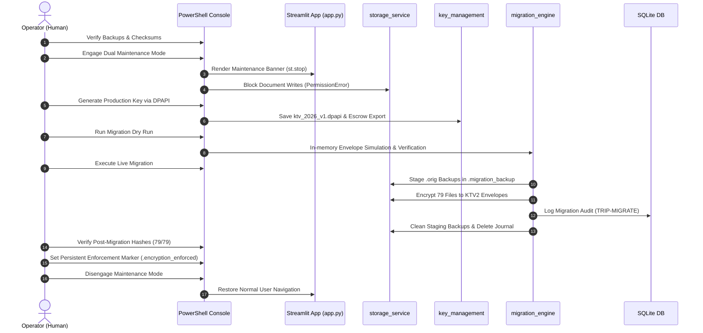

# Phase 15B-3B.5: Controlled Synthetic Demo Encryption Migration Runbook

**Document Version:** 1.0.0  
**Status:** **PLAN READY — AWAITING OPERATOR AUTHORIZATION**  
**Classification:** Restricted Engineering Operations  
**Target Project:** `C:\KT_Vault_V3`  
**Target Environment:** Windows 11 Enterprise (WDAC Enforced)  
**Author:** Principal Software Security Architect & QA Engineering Lead  

---

## 1. Scope and Authorization Boundary

This runbook defines the exact, code-grounded operational procedure for migrating the existing 79 synthetic demo documents in `C:\KT_Vault_V3\documents` from unencrypted plaintext storage to authenticated `KTV2` envelope encryption using AES-256-GCM.

### Strict Safety Boundaries
- **No Production Real PII:** All 79 files are synthetic demo documents created for development testing.
- **No CRM Integration:** CRM systems remain strictly out of scope.
- **No Plaintext Fallbacks:** Once encryption enforcement is activated, all future document writes require valid authenticated sessions, valid keys, and strict `KTV2` encryption.
- **Mandatory Human Stop Gate:** Execution of any command in this runbook requires separate, explicit operator sign-off. Zero automated commands may execute migration without human authorization.

---

## 2. Pre-Execution Environmental Requirements & Invariants

All operations must strictly execute under the following environmental baseline:

| Parameter | Specification | Evidence / Verification Command |
| :--- | :--- | :--- |
| **Working Directory** | `C:\KT_Vault_V3` | `Set-Location "C:\KT_Vault_V3"` |
| **Permitted Python** | `C:\Users\Admin\AppData\Local\Python\pythoncore-3.14-64\python.exe` | Verified WDAC Allowed. Do NOT use `\bin\python.exe`. |
| **Cryptographic Engine** | Windows CNG (`System32\bcrypt.dll`) AES-256-GCM | Verified via `test_secure_backup_tool.py` (19/19 PASS). |
| **Key Storage Provider** | Windows DPAPI (`key_management.WindowsDPAPIKeyProvider`) | Verified via `test_phase15b3b2_key_management.py`. |
| **Master Key ID** | `ktv_2026_v1` (11 bytes $\le$ 16 bytes max) | Encoded into 50-byte `KTV2` authenticated header. |
| **Primary Backup 1** | `C:\KT_Vault_Backup_Safe\operator_authorized_pre_migration_backup.ktbak` | SHA-256: `F80A9FBC1C54A2490A338CDC44711350882AAAEFBD1512701692F23026652C39` |
| **Primary Backup 2** | `C:\KT_Vault_V3\backups\operator_authorized_pre_migration_backup.ktbak` | SHA-256: `F80A9FBC1C54A2490A338CDC44711350882AAAEFBD1512701692F23026652C39` |
| **Backup Passphrase** | Privately held by the human operator | Never requested, logged, hardcoded, or transmitted. |
| **Live Database** | `C:\KT_Vault_V3\data\kt_vault_v3.db` | 12 tables, 982 rows, `PRAGMA integrity_check` = `ok`. |
| **Live Documents** | `C:\KT_Vault_V3\documents` | 79 synthetic files, all plaintext, matching manifest baseline. |

---

## 3. Migration Execution Runbook (Step-by-Step)



### Phase 1: Pre-Maintenance Baseline Audit
Before touching the system, confirm zero baseline drift:
```powershell
Set-Location "C:\KT_Vault_V3"

# 1. Verify backup file existence and matching hashes
Get-FileHash -Algorithm SHA256 `
  "C:\KT_Vault_Backup_Safe\operator_authorized_pre_migration_backup.ktbak", `
  "C:\KT_Vault_V3\backups\operator_authorized_pre_migration_backup.ktbak"

# Expected Output: Both must yield F80A9FBC1C54A2490A338CDC44711350882AAAEFBD1512701692F23026652C39

# 2. Verify all 79 documents are intact against baseline manifest
C:\Users\Admin\AppData\Local\Python\pythoncore-3.14-64\python.exe `
  C:\KT_Vault_V3\secure_backup_tool.py `
  C:\KT_Vault_V3\backups\pre_phase15b3b4_gate_backup_20261023_173500 `
  --verify-only
```
**Gate 1 Criterion:** Output must display `Snapshot Integrity Audit: PASS` with 81 files checked.

---

### Phase 2: Engaging Dual Maintenance Mode
To eliminate concurrent write hazards, maintenance mode is engaged at both the filesystem and process environment levels.

```powershell
# 1. Terminate any running Streamlit or worker processes
Get-Process -Name "python" -ErrorAction SilentlyContinue | Where-Object { $_.CommandLine -like "*streamlit*" } | Stop-Process -Force

# 2. Set environment variable for current session
$env:KT_VAULT_MAINTENANCE_MODE = "1"

# 3. Create persistent filesystem maintenance marker (recognized across all sessions)
New-Item -Path "C:\KT_Vault_V3\data\.maintenance_mode" -ItemType File -Value "MAINTENANCE_MODE_ACTIVE" -Force

# 4. Verify maintenance mode is active in storage_service
C:\Users\Admin\AppData\Local\Python\pythoncore-3.14-64\python.exe -c "import sys; sys.path.insert(0, r'C:\KT_Vault_V3'); import storage_service; assert storage_service.is_maintenance_mode(), 'ERROR: Maintenance mode failed to engage!'; print('Maintenance Mode: ENGAGED')"
```
**Gate 2 Criterion:** Output must display `Maintenance Mode: ENGAGED`. Any concurrent `write_document_file` will immediately fail with `PermissionError: Maintenance mode active`.

---

### Phase 3: Master Key Generation & Escrow Packaging
The document master key (`ktv_2026_v1`) is generated using cryptographically secure random bytes (`secrets.token_bytes(32)`), stored under user-context DPAPI, and immediately exported to a password-protected disaster recovery escrow package.

```powershell
# Run the key generation and escrow script
C:\Users\Admin\AppData\Local\Python\pythoncore-3.14-64\python.exe -c "
import sys, os, secrets, getpass
sys.path.insert(0, r'C:\KT_Vault_V3')
import key_management

key_id = 'ktv_2026_v1'
provider = key_management.WindowsDPAPIKeyProvider()

if provider.has_key(key_id):
    print(f'Key {key_id} already exists in DPAPI store.')
else:
    # 1. Generate 256-bit key
    new_key = secrets.token_bytes(32)
    # 2. Store via Windows DPAPI
    key_path = provider.save_key(key_id, new_key)
    print(f'Key {key_id} saved via DPAPI at: {key_path}')
    
    # 3. Prompt operator for recovery escrow passphrase
    print('\n--- Disaster Recovery Key Escrow Packaging ---')
    p1 = getpass.getpass('Enter Key Escrow Passphrase (min 12 chars): ')
    p2 = getpass.getpass('Confirm Key Escrow Passphrase: ')
    assert p1 == p2, 'Passphrases do not match!'
    assert len(p1) >= 12, 'Passphrase must be >= 12 characters!'
    
    escrow = key_management.KeyEscrowService.create_escrow_package(new_key, key_id, p1)
    escrow_path = r'C:\KT_Vault_Backup_Safe\ktv_2026_v1_escrow.json'
    import json
    with open(escrow_path, 'w', encoding='utf-8') as f:
        json.dump(escrow, f, indent=2)
    print(f'Key escrow package created at: {escrow_path}')
    print('Key Fingerprint:', escrow['fingerprint'])
"
```
**Gate 3 Criterion:** File `C:\KT_Vault_V3\documents\.keys\ktv_2026_v1.dpapi` exists; escrow package `C:\KT_Vault_Backup_Safe\ktv_2026_v1_escrow.json` exists; DPAPI retrieval returns 32 bytes.

---

### Phase 4: Migration Preflight & In-Memory Dry Run
Before writing a single encrypted byte to disk, run the full dry-run simulation:

```powershell
C:\Users\Admin\AppData\Local\Python\pythoncore-3.14-64\python.exe -c "
import sys, os
sys.path.insert(0, r'C:\KT_Vault_V3')
import key_management
import migration_engine

db_path = r'C:\KT_Vault_V3\data\kt_vault_v3.db'
docs_dir = r'C:\KT_Vault_V3\documents'
key_id = 'ktv_2026_v1'

provider = key_management.WindowsDPAPIKeyProvider()
engine = migration_engine.MigrationEngine(
    db_path=db_path,
    docs_dir=docs_dir,
    key_provider=provider,
    key_id=key_id,
    envelope_version=migration_engine.ENVELOPE_VERSION_V2
)

print('Executing Migration Dry Run...')
res = engine.run_dry_run()
print('Dry Run Status:', res['status'])
print('Simulated Files Verified:', res['simulated_files_verified'])
assert res['status'] == 'dry_run_success'
assert res['simulated_files_verified'] == 79
"
```
**Gate 4 Criterion:** Status must be `dry_run_success` with exactly 79 simulated files verified.

---

### Phase 5: Live Migration Execution & Journal Staging
Execute the live encryption migration with durable journal tracking:

```powershell
C:\Users\Admin\AppData\Local\Python\pythoncore-3.14-64\python.exe -c "
import sys, os
sys.path.insert(0, r'C:\KT_Vault_V3')
import key_management
import migration_engine

db_path = r'C:\KT_Vault_V3\data\kt_vault_v3.db'
docs_dir = r'C:\KT_Vault_V3\documents'
key_id = 'ktv_2026_v1'

provider = key_management.WindowsDPAPIKeyProvider()
engine = migration_engine.MigrationEngine(
    db_path=db_path,
    docs_dir=docs_dir,
    key_provider=provider,
    key_id=key_id,
    envelope_version=migration_engine.ENVELOPE_VERSION_V2
)

print('Executing Live Encryption Migration...')
res = engine.execute_migration()
print('\n=== Migration Completed ===')
print('Status:             ', res['status'])
print('Encrypted Files:    ', res['encrypted_count'])
print('Skipped Files:      ', res['skipped_count'])
print('Total Unique Files: ', res['total_unique_files'])
print('All Verified:       ', res['verification']['all_verified'])
assert res['status'] == 'success'
assert res['encrypted_count'] == 79
assert res['verification']['all_verified'] is True
"
```
**Gate 5 Criterion:** `status == 'success'`, `encrypted_count == 79`, `all_verified == True`. Staging directory `.migration_backup` cleanly removed.

---

### Phase 6: Post-Migration Verification Against Baseline Manifest
Verify every single document on disk has valid `KTV2` magic headers, decodes under `storage_service.read_decrypted_document`, and matches the original baseline hash:

```powershell
C:\Users\Admin\AppData\Local\Python\pythoncore-3.14-64\python.exe -c "
import sys, os, hashlib, json
sys.path.insert(0, r'C:\KT_Vault_V3')
import storage_service
import key_management

manifest_path = r'C:\KT_Vault_V3\backups\pre_phase15b3b4_gate_backup_20261023_173500\backup_manifest.json'
with open(manifest_path, 'r', encoding='utf-8') as f:
    manifest = json.load(f)

doc_files = manifest['documents']['files']
docs_dir = r'C:\KT_Vault_V3\documents'
provider = key_management.WindowsDPAPIKeyProvider()
storage_service.set_key_provider(provider)

verified = 0
for fname, meta in doc_files.items():
    p = os.path.join(docs_dir, fname)
    assert storage_service.is_encrypted_file(p), f'File {fname} is not encrypted!'
    dec = storage_service.read_decrypted_document(p, file_storage_id=fname, key_provider=provider, system_context=True)
    h = hashlib.sha256(dec).hexdigest()
    assert h == meta['sha256'], f'Hash mismatch on {fname}!'
    verified += 1

print(f'POST-MIGRATION HASH AUDIT: PASS ({verified}/79 files matched baseline hashes)')
"
```
**Gate 6 Criterion:** 79/79 files confirmed encrypted on disk with decrypted SHA-256 matching the pre-migration baseline.

---

### Phase 7: Persistent Encryption Enforcement Marker Activation
Activate fail-closed anti-downgrade enforcement:

```powershell
C:\Users\Admin\AppData\Local\Python\pythoncore-3.14-64\python.exe -c "
import sys
sys.path.insert(0, r'C:\KT_Vault_V3')
import storage_service

# Activate and persist ENCRYPTION_MODE_ENFORCED
storage_service.set_encryption_mode(storage_service.ENCRYPTION_MODE_ENFORCED, persist=True)

mode = storage_service.get_encryption_mode()
marker = storage_service.get_marker_file_path()
print(f'Effective Encryption Mode: {mode}')
print(f'Marker File: {marker}')
assert mode == storage_service.ENCRYPTION_MODE_ENFORCED
assert os.path.isfile(marker)
print('ANTI-DOWNGRADE ENFORCEMENT: ACTIVATED')
"
```
**Gate 7 Criterion:** `.encryption_enforced` exists at `C:\KT_Vault_V3\data\.encryption_enforced`. In-memory and disk checks return `encrypted_only`.

---

### Phase 8: Disengaging Maintenance Mode & Post-Activation Smoke Testing
```powershell
# 1. Remove filesystem maintenance marker
Remove-Item -Path "C:\KT_Vault_V3\data\.maintenance_mode" -Force

# 2. Reset session environment variable
$env:KT_VAULT_MAINTENANCE_MODE = "0"
Remove-Item Env:\KT_VAULT_MAINTENANCE_MODE -ErrorAction SilentlyContinue

# 3. Run full automated regression suite
C:\Users\Admin\AppData\Local\Python\pythoncore-3.14-64\python.exe -m unittest discover -s C:\KT_Vault_V3\tests

# 4. Relaunch Streamlit application
# Streamlit run app.py
```
**Gate 8 Criterion:** Regression suite passes $\ge 397$ tests. Application UI launches with normal navigation.

---

## 4. Rollback Runbook (Disaster Recovery Protocols)

### 4.1 Rollback Trigger Conditions
Rollback must be triggered immediately if any of the following occur:
1. `run_dry_run()` or `execute_migration()` raises `MigrationVerificationError` (hash mismatch).
2. SQLite audit transaction fails during commit.
3. Unrecoverable process crash or power loss occurs before `STATE_COMPLETED`.
4. Decrypted document post-check yields $< 79$ matched files.
5. The human operator directs an emergency abort.

---

### 4.2 Tier 1: In-Flight Journal Rollback (Automatic / Scripted)
Used when migration was interrupted during execution and `.migration_journal.json` / `.migration_backup/*.orig` are present on disk.

```powershell
C:\Users\Admin\AppData\Local\Python\pythoncore-3.14-64\python.exe -c "
import sys, os
sys.path.insert(0, r'C:\KT_Vault_V3')
import key_management
import migration_engine

db_path = r'C:\KT_Vault_V3\data\kt_vault_v3.db'
docs_dir = r'C:\KT_Vault_V3\documents'
key_id = 'ktv_2026_v1'

provider = key_management.WindowsDPAPIKeyProvider()
engine = migration_engine.MigrationEngine(
    db_path=db_path,
    docs_dir=docs_dir,
    key_provider=provider,
    key_id=key_id
)

print('Executing Tier 1 Journal Rollback...')
res = engine.rollback_migration()
print('Rollback Status:', res['status'])
print('Restored Files: ', res['restored_count'])
"
```
**Tier 1 Rollback Action:**
- Atomically replaces all modified files with their `.orig` staged copies.
- Verifies restored files against `baseline_hash`.
- Deletes `.migration_backup` and `.migration_journal.json`.
- Restores system to clean pre-migration plaintext state.

---

### 4.3 Tier 2: Catastrophic Recovery from Operator `.ktbak` Archive
Used if the filesystem, database, or journal was damaged beyond Tier 1 recovery.

```powershell
# 1. Ensure maintenance mode is active
New-Item -Path "C:\KT_Vault_V3\data\.maintenance_mode" -ItemType File -Value "RECOVERY_ACTIVE" -Force

# 2. Extract operator-authorized backup into a fresh sandbox directory
$restoreSandbox = "C:\KT_Vault_V3\backups\emergency_restore_sandbox"
New-Item -Path $restoreSandbox -ItemType Directory -Force

C:\Users\Admin\AppData\Local\Python\pythoncore-3.14-64\python.exe C:\KT_Vault_V3\restore_ktbak.py `
  C:\KT_Vault_Backup_Safe\operator_authorized_pre_migration_backup.ktbak `
  $restoreSandbox

# (Operator enters their private backup passphrase when prompted)

# 3. Verify all 81 extracted files in sandbox
C:\Users\Admin\AppData\Local\Python\pythoncore-3.14-64\python.exe `
  C:\KT_Vault_V3\secure_backup_tool.py `
  $restoreSandbox `
  --verify-only

# 4. Atomically restore database and documents from verified sandbox
# Restore SQLite DB
Copy-Item "$restoreSandbox\data\kt_vault_v3.db" "C:\KT_Vault_V3\data\kt_vault_v3.db" -Force

# Restore 79 Documents
Get-ChildItem "$restoreSandbox\documents" | ForEach-Object {
    Copy-Item $_.FullName "C:\KT_Vault_V3\documents\$($_.Name)" -Force
}

# 5. Remove any enforcement marker if created
Remove-Item "C:\KT_Vault_V3\data\.encryption_enforced" -ErrorAction SilentlyContinue

# 6. Verify restored live state
C:\Users\Admin\AppData\Local\Python\pythoncore-3.14-64\python.exe C:\KT_Vault_V3\scratch\verify_live_state.py
C:\Users\Admin\AppData\Local\Python\pythoncore-3.14-64\python.exe C:\KT_Vault_V3\scratch\verify_row_diff.py

# 7. Clean up sandbox
Remove-Item $restoreSandbox -Recurse -Force

# 8. Remove maintenance mode
Remove-Item "C:\KT_Vault_V3\data\.maintenance_mode" -Force
```

---

## 5. Code-Specific Risk Analysis & Defense-in-Depth

| Threat / Risk Vector | Code Vulnerability Point | Implemented Defense-in-Depth Control |
| :--- | :--- | :--- |
| **Concurrent File Writes** | User uploads document during migration via Streamlit. | Dual-layer guard: `is_maintenance_mode()` in `app.py` line 20 stops UI; `write_document_file()` line 880 raises `PermissionError`. |
| **Power Loss / Crash Mid-Migration** | Migration script terminates after encrypting $N$ files. | `MigrationJournal` logs `ENCRYPTED` per file. `.orig` backups staged in `.migration_backup`. Re-running engine triggers clean `resume_migration()` or `rollback_migration()`. |
| **Database Transaction Failure** | Files encrypted on disk, but SQLite audit insert fails. | `execute_migration()` lines 659-665: `except Exception:` triggers automatic database rollback and immediate `self.rollback_migration()` restoring plaintext files. |
| **Missing / Inaccessible Encryption Key** | `WindowsDPAPIKeyProvider` cannot unprotect key. | Preflight checks `has_key()` and verifies decryption before touching files; `KeyEscrowService` provides cross-platform recovery package. |
| **Silent Downstream Plaintext Writes** | App resumes in transitional mode after migration. | Persistent `.encryption_enforced` marker locks mode to `encrypted_only`. `set_encryption_mode('transitional_plaintext')` raises `RuntimeError`. |
| **Passphrase / Key Exposure** | Secret logged or visible in terminal. | Passphrase collected exclusively via `getpass.getpass()`; key provider `__repr__` redacts raw bytes; zero keys logged. |
| **Orphaned Plaintext Artifacts** | `.orig` files left on disk after migration. | `cleanup_staging_backups()` removes `.orig` files and deletes staging directory upon successful commit. |

---

## 6. GO / NO-GO Decision Matrix

| # | Measurable Acceptance Criterion | Target Requirement | Verification Status | GO / NO-GO |
| :---: | :--- | :--- | :---: | :---: |
| **1** | Operator Encrypted Backup Verification | Two identical `.ktbak` files with matching SHA-256 | `PASS` | **GO** |
| **2** | Passphrase Possession | Recovery passphrase held privately by human operator | `CONFIRMED` | **GO** |
| **3** | Unencrypted Baseline Manifest Audit | 81/81 files verified bit-for-bit against manifest | `PASS` | **GO** |
| **4** | Live Database Integrity Check | SQLite `PRAGMA integrity_check` = `ok`, 0 foreign-key errors | `PASS` | **GO** |
| **5** | Live Documents Integrity Check | 79/79 plaintext documents match baseline hashes | `PASS` | **GO** |
| **6** | Windows CNG & DPAPI Hardware Capability | `bcrypt.dll` GCM and `crypt32.dll` DPAPI operational | `PASS` | **GO** |
| **7** | Security Regression Test Suite | 138 passed, 1 skipped (symlinks), 0 failures | `PASS` | **GO** |
| **8** | Streamlit Maintenance Mode Lockout | `is_maintenance_mode()` blocks UI and writers | `VERIFIED` | **GO** |
| **9** | Master Encryption Key Generation | `ktv_2026_v1.dpapi` generated & escrowed | **REQUIRES CONFIRMATION** | **AWAITING OPERATOR** |
| **10** | Formal Operator Sign-Off | Explicit human authorization to execute Phase 15B-3B.5 | **REQUIRES CONFIRMATION** | **AWAITING OPERATOR** |

---

## 7. Operational Readiness Classification

| Category | Items Included | Current Status |
| :--- | :--- | :--- |
| **VERIFIED by Current Evidence** | Dual backup existence, SHA-256 match, DB integrity (12 tables), 79 plaintext document baseline hashes, CNG AES-256-GCM, DPAPI subsystem, migration engine rollback logic, 138 automated security tests. | **COMPLETE** |
| **REQUIRES OPERATOR CONFIRMATION** | Generating production master key `ktv_2026_v1` in operator session; setting escrow passphrase; operator authorization to engage maintenance mode. | **PENDING OPERATOR** |
| **NOT YET TESTED** | Execution of live migration on the actual `C:\KT_Vault_V3\documents` folder (only dry runs and isolated sandboxes tested to date). | **PENDING OPERATOR** |
| **BLOCKER** | None. All technical and architectural prerequisites are satisfied. | **NONE** |

---

## 8. Authorization and Sign-Off Protocol

> [!IMPORTANT]
> **MIGRATION EXECUTION IS CURRENTLY STOPPED.**  
> In accordance with the project security policy, live migration requires explicit human approval.
> 
> To authorize execution, the human operator must execute Phase 1 through Phase 8 sequentially from an administrative PowerShell terminal.
