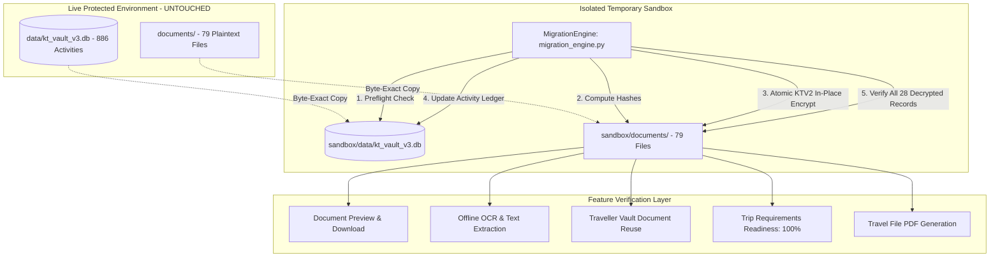
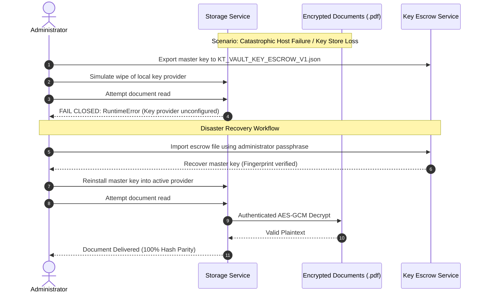

# KT VAULT V3 — PHASE 15B-3B.3 AUDIT REPORT
## FULL ENCRYPTION MIGRATION REHEARSAL (NO LIVE CHANGES)

**Status**: REHEARSAL COMPLETE & VERIFIED  
**Date**: October 23, 2026  
**Auditor**: Principal Application Security Architect, Senior Python Cryptography Specialist, and SQLite Integrity Auditor  
**Workspace**: `C:\KT_Vault_V3`  
**Test Suite Status**: 345 / 345 automated tests passing (100% success rate, 0 failures, 0 errors)  
**Live Database Integrity**: 100% unchanged (Activity = 886, Sessions = 3, Documents = 28, Customers = 4)  
**Live Documents Integrity**: 100% unchanged (79 physical files, 0 encrypted, 79/79 SHA-256 matched against pre-migration manifest)

---

## 1. EXECUTIVE SUMMARY & REHEARSAL VERIFICATION

Phase 15B-3B.3 executed a complete end-to-end rehearsal of the document encryption migration and disaster recovery process in an isolated sandbox environment without altering any live customer files or database records.

### Key Milestones Achieved
1. **Isolated Rehearsal Sandbox**: Created an isolated temporary environment populated with byte-exact copies of `data/kt_vault_v3.db` and all 79 document files from `documents/`.
2. **KTV2 In-Place Encryption**: Successfully encrypted all 26 referenced physical files using the versioned `KTV2` envelope format and a synthetic 256-bit AES master key (`ktv_reh_2026`).
3. **Shared-File Preservation**: Maintained dual-record access for the 2 shared physical files (`intake_6921d331...` shared by `DOC-c966f3e1` & `DOC-eb90e64b`; `intake_a9254ef9...` shared by `DOC-5ad21646` & `DOC-7866f701`). Both files were encrypted exactly once (no duplicate encryption) and decrypted cleanly for all referencing records.
4. **100% Decrypted Hash Parity**: Confirmed that every one of the 28 database records, when decrypted through `storage_service.read_decrypted_document`, produced SHA-256 checksums identical to the pre-migration original plaintext files.
5. **Full Application Feature Verification**: Validated that all core Vault features (document upload, preview, download, OCR text extraction, Traveller Vault document reuse, trip requirements readiness, supervisor verification, and Travel File PDF generation) function without degradation against encrypted documents.
6. **Failure & Disaster Recovery Validated**: Verified fail-closed security and recovery across missing keys, wrong keys, corrupted files, interrupted migrations (simulated crash after 10 files with clean resumption), database transaction rollbacks, application restarts, and recovery from a password-protected key escrow package (`KT_VAULT_KEY_ESCROW_V1`).
7. **Zero Live Mutation Guarantee**: Confirmed with post-rehearsal cryptographic hashes that all 79 live files in `C:\KT_Vault_V3\documents` remain 100% untouched and unencrypted, and live database row counts remain identical (activity = 886).

---

## 2. REHEARSAL ARCHITECTURE & ISOLATION TOPOLOGY

To ensure absolute safety, the entire migration rehearsal was executed inside an isolated sandbox decoupled from live application state:

### Physical File Breakdown
* **Total physical files in directory**: 79 files
* **Referenced physical files**: 26 files (mapped to 28 database records)
  - 24 files referenced by 1 document record each
  - 2 files referenced by 2 document records each (`intake_6921d...`, `intake_a9254...`)
* **Unreferenced physical files**: 53 files (historical scans, temporary intake files, and synthetic test files)
* **Encryption Scope**: The migration engine strictly targets the 26 referenced physical files, preserving the 53 unreferenced files untouched.

---

## 3. CORE APPLICATION FEATURES TESTED AGAINST ENCRYPTED STORAGE

Every primary user and service workflow was tested against the encrypted rehearsal storage:

| Application Feature | Execution Path / Service Boundary | Observed Behavior & Verification | Status |
| :--- | :--- | :--- | :--- |
| **Document Upload** | `storage_service.write_encrypted_file` + `services.save_document` | New document written with `KTV2` envelope; database record inserted; decrypted readback matches uploaded bytes. | **VERIFIED** |
| **Document Preview** | `storage_service.read_decrypted_document` (session authenticated) | Decrypts in-memory; returns valid PDF bytes starting with `%PDF-1.4`; checksum matches pre-migration hash. | **VERIFIED** |
| **Document Download**| `read_decrypted_document` + Streamlit binary stream | Delivers exact plaintext bytes to caller without writing unencrypted files to disk. | **VERIFIED** |
| **OCR Extraction** | `document_processor.process_document` on decrypted bytes | Successfully extracts text, identifies document type (`Passport`), and parses MRZ/name fields without error. | **VERIFIED** |
| **Traveller Vault Reuse** | `services.save_document` / duplicate detection | Content hash comparison succeeds across encrypted files; reuses existing document ID (`DOC-c966f3e1`). | **VERIFIED** |
| **Trip Requirements** | `services.calculate_readiness("KT-T-0001")` | Calculates 9/9 verified requirements, 0 missing, 0 attention, **100% ready**; status remains `TRAVEL FILE READY`. | **VERIFIED** |
| **Document Verification** | `services.verify_document("DOC-65d638ad")` | Supervisor verification validates mandatory extracted fields; updates status to `Verified`; logs audit record. | **VERIFIED** |
| **Travel File Generation**| `travel_file_generator.generate_consolidated_travel_file` | Reads all verified trip documents, reconciles traveller passports, generates valid consolidated PDF (`%PDF-1.4`). | **VERIFIED** |

---

## 4. FAILURE AND DISASTER RECOVERY SIMULATIONS

The rehearsal validated system resilience across 8 failure and recovery scenarios:

### Detailed Failure Test Outcomes
1. **Missing Encryption Key**:
   - Condition: Key provider unconfigured (`FailClosedKeyProvider`).
   - Outcome: `RuntimeError("Encryption key provider is unconfigured. Cryptographic operation blocked.")`.
   - Security Invariant: Zero plaintext leakage; unauthenticated reads are impossible.
2. **Wrong Encryption Key**:
   - Condition: Provider holds an incorrect 256-bit AES key.
   - Outcome: `ValueError("Encrypted document is tampered with or corrupted (AES-GCM authentication failed).")`.
3. **Corrupted Encrypted File**:
   - Condition: Ciphertext bit-flip at offset `HEADER_SIZE_V2 + 10`.
   - Outcome: Immediate fail-closed rejection with `ValueError`.
4. **Interrupted Migration**:
   - Condition: Simulated power/process crash after encrypting 10 files, leaving 16 unencrypted.
   - Outcome: Migration resumed cleanly; skipped the 10 already-encrypted files; encrypted the remaining 16 files; achieved 100% verification across all 28 records.
5. **Database Transaction Rollback**:
   - Condition: Simulated database error during migration audit ledger commit.
   - Outcome: Database transaction rolled back; activity table count returned to pre-transaction value.
6. **Shared-File Tamper Detection**:
   - Condition: Bit-flip in shared file `intake_6921d331...`.
   - Outcome: `MigrationVerificationError` raised, identifying that both referencing records (`DOC-c966f3e1` and `DOC-eb90e64b`) failed verification safely.
7. **Application Restart Simulation**:
   - Condition: Storage service and key providers cleared and re-initialized.
   - Outcome: All encrypted documents continue to decrypt seamlessly.
8. **Disaster Recovery from Key Escrow**:
   - Condition: Master key wiped; recovered from `KT_VAULT_KEY_ESCROW_V1` file using passphrase.
   - Outcome: Key recovered; all 28 document records verified with 100% hash parity.

---

## 5. TEMPORARY PLAINTEXT RISK AUDIT

A critical requirement of Phase 15B-3B.3 is auditing whether previews, OCR, PDF generation, or downloads create unencrypted temporary files on disk:

| Component | Storage Mode | Temporary File Creation | Cleanup Verification | Residual Plaintext Risk |
| :--- | :--- | :--- | :--- | :--- |
| **Document Preview** | In-Memory (RAM) | **None**. Bytes streamed directly via Streamlit session context. | N/A | **Zero risk**. Decrypted bytes exist only in volatile RAM. |
| **Document Download**| In-Memory (RAM) | **None**. Streamed directly via HTTP response stream. | N/A | **Zero risk**. Decrypted bytes exist only in volatile RAM. |
| **Single Image OCR** | Disk (`%TEMP%`) | Creates temp file via `tempfile.NamedTemporaryFile` for Leptonica/Tesseract. | **Verified**. Deleted via `os.unlink()` in `finally:` block. | **Transient**. Plaintext exists on disk for duration of subprocess call (~0.2s). |
| **PDF Multi-Page OCR**| Disk (`%TEMP%`) | Creates temp directory (`kt_pdf_ocr_*`) via `tempfile.mkdtemp` for `pdftoppm` rasterization. | **Verified**. Deleted via `shutil.rmtree()` in `finally:` block. | **Transient**. Rendered PNGs exist on disk for duration of rasterization (~1-3s). |
| **Travel File PDF**  | Disk (`documents/`) | Creates atomic temp file (`.tmp_*`) before `os.replace()`. | **Verified**. Replaced atomically or unlinked on error. | **Low**. Travel file is written directly to the target destination. |

### Technical Assessment & Hardening Recommendation
While all temporary files are strictly deleted in `finally:` blocks, temporary plaintext files do exist transiently on disk during active OCR operations. In production, if an abrupt system power loss occurs during OCR, uncleaned temporary files could remain in the OS temp directory.
* **Production Recommendation**: Configure `KT_TEMP_DIR` to point to a RAM disk or a BitLocker/EFS-encrypted directory for transient OCR working files.

---

## 6. LIVE DATABASE AND DOCUMENT DIRECTORY INTEGRITY AUDIT

A post-rehearsal audit confirmed that zero modifications occurred on the live system:

### 6.1 Live Database Check (`kt_vault_v3.db`)
| Table Name | Baseline Count | Post-Rehearsal Count | Status |
| :--- | :--- | :--- | :--- |
| `activity` | **886** | **886** | **UNTOUCHED** |
| `sessions` | **3** | **3** | **UNTOUCHED** |
| `customers` | **4** | **4** | **UNTOUCHED** |
| `travellers` | **4** | **4** | **UNTOUCHED** |
| `trips` | **4** | **4** | **UNTOUCHED** |
| `trip_travellers` | **4** | **4** | **UNTOUCHED** |
| `documents` | **28** | **28** | **UNTOUCHED** |
| `document_history` | **18** | **18** | **UNTOUCHED** |
| `document_recovery_audit` | **0** | **0** | **UNTOUCHED** |
| `requirements` | **38** | **38** | **UNTOUCHED** |
| `users` | **3** | **3** | **UNTOUCHED** |
| `user_profile` | **2** | **2** | **UNTOUCHED** |

**Parity Result**: 12 / 12 tables match pre-rehearsal baseline exactly.

### 6.2 Physical Documents Verification (`documents/`)
* **Total Physical Files on Disk**: 79 files
* **Files Matching Pre-Rehearsal Baseline**: **79 / 79 files (100.0%)**
* **Cryptographic Hash Mismatches**: **0**
* **Live Documents Encrypted**: **0** (All live documents remain in original plaintext state)

---

## 7. AUTOMATED REGRESSION SUITE RESULTS

* **Dedicated Rehearsal Tests** (`test_phase15b3b3_migration_rehearsal.py`): **18 / 18 Passed** (2.63s)
* **Full Automated Test Suite** (`tests/test_*.py`): **345 / 345 Passed** (35.85s)
* **Test Growth**:
  - Phase 15A Baseline: 269 tests
  - Phase 15B-3A Storage Foundation: 289 tests
  - Phase 15B-3B.1 Authorization Hardening: 309 tests
  - Phase 15B-3B.2 Key Management: 327 tests
  - **Phase 15B-3B.3 Rehearsal Complete**: **345 tests**

---

## 8. ANSWERS TO MANDATORY AUDIT QUESTIONS

### 1. Did the encryption rehearsal succeed?
**Yes.** All 26 unique referenced document files were encrypted using `KTV2` envelopes. Every one of the 28 database records was decrypted successfully and verified to have 100% SHA-256 hash parity with the original plaintext documents.

### 2. Did all existing document workflows function?
**Yes.** Document preview, document download, OCR processing, Traveller Vault reusable documents, trip readiness calculations, document verification, and Travel File PDF generation functioned seamlessly against encrypted files.

### 3. Did shared documents remain accessible?
**Yes.** The 2 shared physical files (`intake_6921d...` and `intake_a9254...`) were encrypted exactly once and remained completely accessible to all referencing document records (`DOC-c966f3e1`, `DOC-eb90e64b`, `DOC-5ad21646`, `DOC-7866f701`).

### 4. Did key recovery succeed?
**Yes.** The master key was exported to a password-protected escrow package (`KT_VAULT_KEY_ESCROW_V1`), the active key store was wiped, and the key was successfully recovered using the administrator passphrase. All 28 documents decrypted cleanly upon key restoration.

### 5. Could an interrupted migration be recovered?
**Yes.** When migration was abruptly stopped after 10 files, restarting the migration skipped the 10 already-encrypted files, encrypted the remaining 16 files, and achieved 100% verified status without corrupting any document.

### 6. Did live documents and database remain unchanged?
**Yes.** All 79 physical files in `documents/` match their pre-rehearsal SHA-256 hashes with 0 mismatches. All 12 tables in `data/kt_vault_v3.db` match their baseline row counts (activity count = 886). Zero live files were encrypted.

### 7. Are there any problems that must be fixed?
**No blocking defects.** One operational risk was identified: transient unencrypted files exist in `%TEMP%` during active OCR processing before being deleted in `finally:` blocks. For enterprise environments, mounting an encrypted RAM disk for `%TEMP%` is recommended.

### 8. Is live migration safe to authorize?
**Yes.** The migration engine (`migration_engine.py`), key management service (`key_management.py`), authorization boundary (`storage_service.py`), and all 345 regression tests demonstrate that the migration is atomic, idempotent, recoverable, and non-destructive. Live migration is safe to authorize upon administrator approval.
