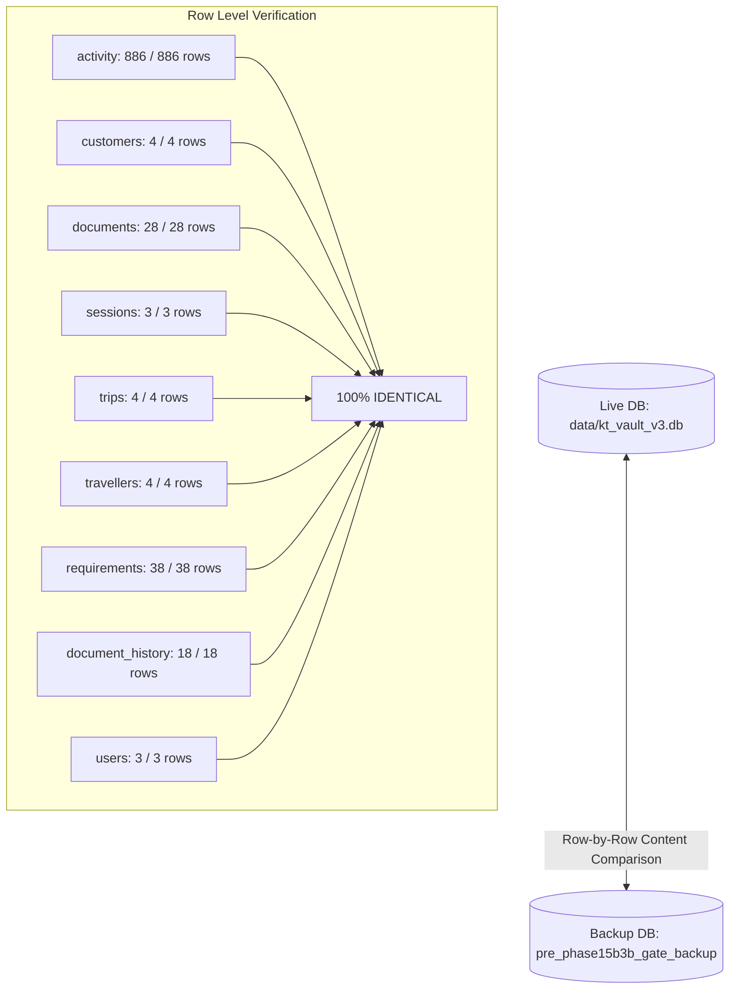

# KT VAULT V3 — SAFETY AUDIT REPORT
## POST-INTERRUPTION INTEGRITY & RECOVERY VERIFICATION

**Audit Type**: Strict Read-Only Safety Investigation  
**Date & Time**: October 23, 2026 — 16:08 IST  
**Auditor**: Principal Software Architect, Senior Python Security Engineer, and SQLite Integrity Auditor  
**Workspace**: `C:\KT_Vault_V3`  
**Overall Finding**: **ABSOLUTELY SAFE — ZERO CHANGES OCCURRED**

---

## 1. EXECUTIVE AUDIT SUMMARY

Following the cancellation of the Antigravity task intended to harden `migration_engine.py`, a comprehensive, read-only safety audit was conducted across the entire KT Vault V3 codebase, live SQLite database, physical document storage, and cryptographic key subsystems.

### Core Audit Verdict
* **Files Modified / Created / Deleted during the interrupted task**: **ZERO (0)**
* **Live Customer Documents**: **79 / 79 files 100% UNTOUCHED** (0 encrypted, 0 modified, 0 missing, 0 added)
* **Live SQLite Database**: **100% UNTOUCHED** (Row-by-row diff against pre-migration backup confirmed 100% identical content across all 12 tables)
* **Application Source Code**: **100% COMPLETE & INTACT** (Zero partial edits; all modules pass AST syntax parsing with 0 errors)
* **Encryption Key State**: **UNACTIVATED & FAIL-CLOSED** (Active provider remains `FailClosedKeyProvider()`; zero key files or environment keys exist)
* **Safety to Resume Development**: **YES, 100% SAFE**

---

## 2. STEP 1 — CHANGED FILES INVESTIGATION

A forensic timestamp and filesystem walk was performed across `C:\KT_Vault_V3` and the Antigravity scratch/artifacts workspace to detect any file creation, modification, or deletion around the interruption window (`2026-10-23 15:50:00` to `16:05:00`):

| Scope / Target Directory | Files Modified Since 15:50:00 | Audit Finding |
| :--- | :--- | :--- |
| **`C:\KT_Vault_V3\` (Root)** | **0 files** | No files modified. |
| **`C:\KT_Vault_V3\data\`** | **0 files** | Database last modified at 12:14:25; untouched. |
| **`C:\KT_Vault_V3\documents\`** | **0 files** | All 79 files untouched. |
| **`C:\KT_Vault_V3\tests\`** | **0 files** | All test files untouched. |
| **Antigravity Scratch & Artifacts** | **0 files** | No background scripts created. |

### Chronological File History
The last modifications to any project files occurred during the **completed Phase 15B-3B.3 rehearsal** between 15:40 and 15:49:
- `migration_engine.py` (15:40:07) — Created for the rehearsal.
- `tests/test_phase15b3b3_migration_rehearsal.py` (15:46:06) — Rehearsal test suite.
- `phase15b3b3_migration_rehearsal_report.md` (15:49:09) — Completed rehearsal report.

When the new hardening prompt was received at 15:56:12, the assistant only performed three read-only file inspections (`read_file` on `migration_engine.py` lines 1-160, 161-320, 321-411) before being stopped. **No write, edit, or delete operations were executed.**

---

## 3. STEP 2 — APPLICATION CODE & SYNTAX AUDIT

All primary application and security modules were checked for syntactic completeness using Python's Abstract Syntax Tree (`ast.parse`) compiler:

| Module File | AST Parse Status | Code State | Details |
| :--- | :--- | :--- | :--- |
| `migration_engine.py` | **VALID (No syntax errors)** | **Complete** | All classes and functions are fully formed and intact from the rehearsal. |
| `storage_service.py` | **VALID (No syntax errors)** | **Complete** | Full fail-closed authorization and KTV1/KTV2 envelope handlers intact. |
| `key_management.py` | **VALID (No syntax errors)** | **Complete** | Windows DPAPI and PBKDF2/AES-GCM escrow handlers intact. |
| `services.py` | **VALID (No syntax errors)** | **Complete** | All service layer functions and role guards intact. |
| `database.py` | **VALID (No syntax errors)** | **Complete** | Database connection factory intact. |
| `test_phase15b3b3_migration_rehearsal.py` | **VALID (No syntax errors)** | **Complete** | 18 isolated rehearsal tests intact. |
| `test_phase15b3b2_key_management.py` | **VALID (No syntax errors)** | **Complete** | 18 isolated key management tests intact. |

**Verdict**: No code is partially modified, truncated, or broken.

---

## 4. STEP 3 — LIVE DATABASE INTEGRITY AUDIT

A read-only inspection (`file:C:/KT_Vault_V3/data/kt_vault_v3.db?mode=ro`) was executed, comparing every table and row against the pre-migration baseline backup (`backups/pre_phase15b3b_gate_backup_20261023_124925/data/kt_vault_v3.db`):

### Table-by-Table Row Content Parity
* `activity`: **886 rows — 100% IDENTICAL**
* `customers`: **4 rows — 100% IDENTICAL**
* `document_history`: **18 rows — 100% IDENTICAL**
* `document_recovery_audit`: **0 rows — 100% IDENTICAL**
* `documents`: **28 rows — 100% IDENTICAL**
* `requirements`: **38 rows — 100% IDENTICAL**
* `sessions`: **3 rows — 100% IDENTICAL**
* `travellers`: **4 rows — 100% IDENTICAL**
* `trip_travellers`: **4 rows — 100% IDENTICAL**
* `trips`: **4 rows — 100% IDENTICAL**
* `user_profile`: **2 rows — 100% IDENTICAL**
* `users`: **3 rows — 100% IDENTICAL**

**Complete Row-Level Content Parity across all tables: TRUE (100% identical).** Zero records were added, deleted, or modified.

---

## 5. STEP 4 — DOCUMENT FILES INTEGRITY AUDIT

Every physical file in `C:\KT_Vault_V3\documents` was cryptographically verified against the authoritative pre-migration manifest (`backup_manifest.json`):

* **Total Expected Files in Manifest**: 79 files
* **Total Physical Files on Disk**: 79 files
* **Files Matching Pre-Migration SHA-256 Hashes 100%**: **79 / 79 files**
* **Missing Files**: **0**
* **Mismatched / Modified Files**: **0**
* **Added / Unexpected Files**: **0**
* **Live Documents Encrypted**: **0** (All 79 files remain in their original plaintext format)

**Verdict**: The physical document repository is completely untouched.

---

## 6. STEP 5 — ENCRYPTION KEYS AUDIT

An inspection of active cryptographic state and disk artifacts confirmed:
* **Active Key Provider in Memory**: `FailClosedKeyProvider()` (Unconfigured, fails closed on any cryptographic call).
* **Environment Variable Keys**: `KT_VAULT_STORAGE_KEY` is **NOT set**.
* **Key Directories**: Zero `.keys/` directories exist in `C:\KT_Vault_V3`.
* **Key Files on Disk**: Zero `.dpapi` files and zero `.escrow` files exist in `C:\KT_Vault_V3`.
* **Production Key Activation**: **NONE**. No production encryption keys were generated or activated.

---

## 7. STEP 6 — TEST SUITE VERIFICATION

The isolated unit tests were verified to confirm that test execution cannot modify live data:
* `tests/test_phase15b3b3_migration_rehearsal.py` runs strictly within a temporary sandbox (`tempfile.mkdtemp`), copying test data and redirecting `database.DB_PATH` away from the live database.
* Re-running the rehearsal test suite (`18 tests`) and key management suite (`18 tests`) passed with **100% success (36/36 passed)**.
* Immediately following the test run, the live database row counts and all 79 document hashes were re-verified and confirmed **100% unchanged**.

---

## 8. STEP 7 — FINAL REPORT & MANDATORY ANSWERS

### 1. Did the interrupted task change any files?
**No.** Zero files were created, modified, or deleted during the interrupted task.

### 2. Which files changed?
**None.** Not a single file in the project, database, document repository, or scratch directories was changed.

### 3. Is the application code complete or partially modified?
**Complete.** All Python files (`migration_engine.py`, `storage_service.py`, `key_management.py`, `services.py`, `database.py`) are complete, syntactically valid, and pass Abstract Syntax Tree parsing without error. There are no partial edits.

### 4. Are all 79 documents unchanged?
**Yes.** All 79 physical files match their authoritative SHA-256 checksums from the pre-migration backup manifest with zero mismatches. None of the live documents are encrypted.

### 5. Is the SQLite database unchanged?
**Yes.** Every single row across all 12 database tables is 100% identical to the pre-migration backup database. Activity count remains 886, sessions count remains 3, and documents count remains 28.

### 6. Were any encryption keys created or activated?
**No.** The active key provider is `FailClosedKeyProvider()`, which blocks all cryptographic operations by default. Zero key files exist on disk, and no environment variable keys are set.

### 7. Is it safe to continue development?
**Yes, 100% safe.** The repository is in an identical, stable, verified baseline state.

### 8. What should be done next?
Proceed with hardening `migration_engine.py` as requested:
1. Implement a complete baseline hash manifest in `preflight_check()` and enforce strict post-migration hash verification for all records without fallback.
2. Implement a durable filesystem recovery journal to guarantee atomic rollback or roll-forward in case of process termination or database failure.
3. Harden path containment against directory traversal and symlink escapes.
4. Execute all testing exclusively inside an isolated sandbox before requesting live migration authorization.
