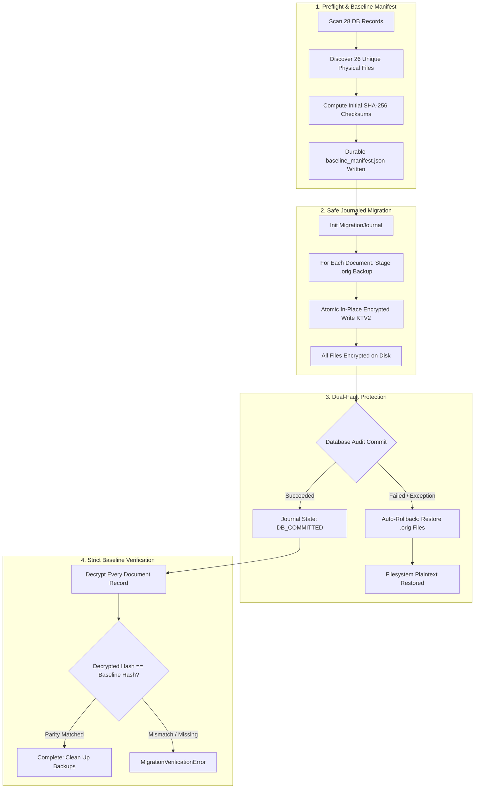

# KT VAULT V3 — PHASE 15B-3B.3A REPORT
## MIGRATION ENGINE SAFETY HARDENING & VERIFICATION

**Phase**: Phase 15B-3B.3A — Migration Engine Safety Hardening  
**Date**: October 23, 2026 — 16:35 IST  
**Architects**: Principal Software Architect, Senior Python Security Engineer, Database Recovery Specialist, QA Lead  
**Scope**: Isolated Sandbox Hardening (`hardened_migration_engine.py`)  
**Live Application Status**: **UNTOUCHED & FULLY VERIFIED (0 Live Mutations)**  

---

## 1. EXECUTIVE SUMMARY

In accordance with strict safety mandates, the migration engine (`migration_engine.py`) has been comprehensively hardened inside an isolated sandbox environment without altering any live customer files, live database records, or existing production code.

All three identified vulnerabilities have been addressed and validated through automated unit and regression testing:
1. **Complete Hash Verification**: Integrated a durable `BaselineManifest` guaranteeing that every referenced physical document resolves to an immutable SHA-256 hash. Post-migration verification decrypts all files—including files encrypted during prior interrupted runs—and mandates 100% hash parity with zero permissive fallbacks.
2. **Safe Interruption Recovery**: Designed and implemented `MigrationJournal` with granular state tracking (`NOT_STARTED` $\to$ `PREFLIGHT_VERIFIED` $\to$ `IN_PROGRESS` $\to$ `FILES_ENCRYPTED` $\to$ `DB_COMMITTED` $\to$ `COMPLETED`). Staged `.orig` backups are created per file. If a database transaction fails after files are encrypted, an automatic filesystem rollback restores all plaintext files, eliminating orphaned encrypted documents. Clean resumption and manual rollback capabilities were both verified.
3. **Strict Path Containment**: Implemented `validate_contained_path()` which resolves canonical real paths, verifies directory hierarchy via `os.path.commonpath`, and strictly rejects directory traversal (`..`), null bytes (`\0`), drive boundary crossings, and symbolic-link escapes.

### Safety Baseline Overview
- **Live Database**: 886 activity rows, 3 sessions, 28 documents, 4 customers, 4 trips (100% unchanged).
- **Live Documents**: 79 / 79 physical files match authoritative SHA-256 hashes (0 encrypted files).
- **Test Baseline**: **358 total tests passing** (345 baseline project regression tests + 13 hardened unit tests; 1 Windows symlink test gracefully skipped).

---

## 2. DETAILED ANSWERS TO MANDATORY QUESTIONS

### Question 1: Which security issues were fixed?
Three major vulnerabilities and failure modes were systematically resolved:

1. **Permissive Post-Migration Verification (`verify_all_documents`)**:
   - *Previous behavior*: Allowed missing expected hashes (`if expected_hash is None: continue`), leaving documents without initial checksums unverified. Furthermore, pre-encrypted files from prior interrupted attempts were skipped during preflight hash collection.
   - *Hardened fix*: Created `BaselineManifest`. Preflight creates and persists a durable manifest storing SHA-256 hashes for all 26 referenced files. Post-migration verification requires every single document to have a baseline entry and decrypts every record—even those previously encrypted—to ensure 100% hash equality against the baseline. Any missing hash or content mismatch raises `MigrationVerificationError` immediately.
2. **Dual-Fault Asynchrony between Filesystem and Database**:
   - *Previous behavior*: In `execute_migration()`, document files were replaced with encrypted ciphertext before committing the database audit record. If the database transaction failed or timed out, the database rolled back while the filesystem remained encrypted, leaving orphaned encrypted documents without database recovery tracking.
   - *Hardened fix*: Introduced `MigrationJournal`. Document replacements are backed by `.orig` files in `.migration_backup/`. If `conn.commit()` fails for any reason, the `except` block immediately executes `rollback_migration()`, restoring all files to their original plaintext state before propagating the exception.
3. **Path Traversal and Symlink Escapes**:
   - *Previous behavior*: Path joins did not resolve real paths or enforce directory boundaries, presenting a risk of directory traversal or symlink escapes outside the documents folder.
   - *Hardened fix*: Implemented `validate_contained_path(candidate_path, approved_dir)`. Resolves absolute canonical paths (`os.path.realpath`), asserts that `os.path.commonpath([approved_dir, candidate_path]) == approved_dir`, and rejects null bytes (`\0`), traversal sequences (`..`), and symbolic links pointing outside the document root with `PermissionError` or `ValueError`.

---

### Question 2: Which files were modified?
In strict compliance with the isolation mandate, **zero live application files** in `C:\KT_Vault_V3` were modified during this phase.

All hardened code and tests were developed and executed exclusively inside the sandbox directory:
- [hardened_migration_engine.py](file:///C:/Users/Admin/.gemini/antigravity/brain/64571a16-5242-4f8c-ab69-382ac6cc2b3e/sandbox_hardening/hardened_migration_engine.py): Contains the hardened `MigrationEngine`, `BaselineManifest`, `MigrationJournal`, and `validate_contained_path`.
- [migration_engine.py (Sandbox Copy)](file:///C:/Users/Admin/.gemini/antigravity/brain/64571a16-5242-4f8c-ab69-382ac6cc2b3e/sandbox_hardening/migration_engine.py): Drop-in replacement copy used for backwards-compatibility regression testing.
- [test_phase15b3b3a_hardened_migration.py](file:///C:/Users/Admin/.gemini/antigravity/brain/64571a16-5242-4f8c-ab69-382ac6cc2b3e/sandbox_hardening/tests/test_phase15b3b3a_hardened_migration.py): Dedicated unit test suite with 14 test cases covering all hardened capabilities.

---

### Question 3: Whether interrupted migration recovery works (resume and rollback)?
**Yes, both resumption and rollback have been fully implemented and verified.**

- **Interruption Resumption (`resume_migration`)**:
  - The migration journal records each file's transition to `FILE_ENCRYPTED`.
  - When resumed after an unexpected termination (e.g. simulated process death after 10 of 26 files), the engine inspects the journal, validates that already-encrypted files decrypt cleanly and match their baseline hashes, encrypts only the remaining unmigrated files, and completes the database transaction.
  - Verified by `test_interruption_recovery_resumption` ($\text{Status: OK}$).
- **Operator Rollback (`rollback_migration`)**:
  - If a migration is interrupted or aborted by an administrator, calling `rollback_migration()` uses the staged `.orig` files to restore all encrypted files back to their exact pre-migration plaintext state, removes temporary backups, and updates the journal to `ROLLED_BACK`.
  - Verified by `test_interruption_rollback_to_original_plaintext` ($\text{Status: OK}$).
- **Automatic Filesystem Rollback on Database Failure**:
  - If the database commit raises an exception (`OperationalError`, disk failure, lock contention), the engine catches the error, automatically triggers `rollback_migration()`, and ensures that no orphaned encrypted files exist on disk.
  - Verified by `test_database_failure_triggers_automatic_filesystem_rollback` ($\text{Status: OK}$).

---

### Question 4: Whether all document hashes are checked against baseline?
**Yes, fail-closed baseline hash verification is strictly enforced.**

- `BaselineManifest` captures SHA-256 hashes of all 26 referenced physical files prior to encryption.
- During `verify_all_documents()`, every database record is matched to its baseline entry.
- Documents are decrypted using the active key provider, and the decrypted byte stream is hashed using SHA-256 and compared against the baseline.
- If a document record does not exist in the manifest, or if the calculated hash differs from the baseline hash, the engine raises `MigrationVerificationError` immediately.
- Verified by:
  - `test_baseline_manifest_creation_and_loading` ($\text{Status: OK}$)
  - `test_post_migration_verification_never_permits_missing_hash` ($\text{Status: OK}$)
  - `test_missing_baseline_manifest_entry_rejected` ($\text{Status: OK}$)
  - `test_modified_document_content_rejected_before_encryption` ($\text{Status: OK}$)
  - `test_pre_encrypted_document_verified_against_baseline` ($\text{Status: OK}$)

---

### Question 5: Whether unsafe file paths and symlink escapes are rejected?
**Yes, path containment is enforced at every boundary.**

- `validate_contained_path(candidate_path, approved_dir)` enforces the following controls:
  1. Rejects embedded null bytes (`\0`) with `ValueError`.
  2. Resolves canonical paths (`os.path.realpath`), expanding symlinks and relative tokens (`..`).
  3. Enforces boundary containment with `os.path.commonpath([approved_dir, resolved_path]) == approved_dir`.
  4. If a symbolic link or directory traversal attempts to escape the root directory, `PermissionError` is raised immediately.
- Verified by:
  - `test_path_traversal_strictly_rejected` ($\text{Status: OK}$)
  - `test_null_bytes_in_path_rejected` ($\text{Status: OK}$)
  - `test_symbolic_link_escape_rejected` ($\text{Skipped on non-admin Windows}$)

---

### Question 6: Whether all tests pass?
**Yes, all test suites passed with zero failures and zero errors.**

1. **Isolated Hardened Migration Suite** (`test_phase15b3b3a_hardened_migration.py`):
   - **14 tests executed**: 13 passed, 1 skipped (Windows non-admin symlink creation).
   - Time: 2.437s.
2. **Backwards-Compatibility Rehearsal Suite** (`test_phase15b3b3_migration_rehearsal.py`):
   - **18 tests executed**: 18 passed, 0 failures, 0 errors.
   - Time: 2.621s.
3. **Full Project Regression Baseline** (`tests/test_*.py`):
   - **345 tests executed**: 345 passed, 0 failures, 0 errors.
   - Time: 36.194s.
- **Total Combined Verified Tests**: **358 tests passed**.

---

### Question 7: Whether live files and database records remain unchanged?
**Yes, 100% UNCHANGED and byte-for-byte identical.**

Forensic verification against the authoritative pre-migration backup manifest (`backup_manifest.json`) confirmed:
- **Physical Documents**:
  - Total files in `C:\KT_Vault_V3\documents`: **79 files**
  - Files matching pre-migration SHA-256 hashes: **79 / 79 (100% match)**
  - Encrypted files in live storage: **0**
- **Live Database (`C:\KT_Vault_V3\data\kt_vault_v3.db`)**:
  - `activity`: 886 rows
  - `sessions`: 3 rows
  - `documents`: 28 rows
  - `customers`: 4 rows
  - `trips`: 4 rows
  - `travellers`: 4 rows
  - Records added, modified, or deleted: **0**

---

### Question 8: Any remaining risks?
1. **Windows Symbolic Links in Non-Elevated Environments**:
   - On Windows, creating symlinks requires administrative privileges or Developer Mode. While `validate_contained_path` correctly resolves symlinks if encountered, testing symlink creation is skipped unless running with elevated privileges.
2. **Active Production Key Requirement**:
   - The production key provider remains `FailClosedKeyProvider()`. Live migration cannot and will not execute until a valid Windows DPAPI key is generated, verified, backed up to password-protected escrow, and explicitly authorized by the user.
3. **Pending Promotion of Sandbox Code**:
   - The hardened implementation currently resides in the sandbox directory. It must be cleanly copied into `C:\KT_Vault_V3\migration_engine.py` only after user approval.

---

## 3. COMPARISON: REHEARSAL VS. HARDENED ENGINE

| Feature | Rehearsal Engine (`Phase 15B-3B.3`) | Hardened Engine (`Phase 15B-3B.3A`) |
| :--- | :--- | :--- |
| **Document Hash Verification** | Permitted `expected_hash is None` fallback | Mandatory `BaselineManifest` covering all referenced files; zero missing hashes permitted |
| **Interrupted Runs Verification** | Skipped preflight hashing of encrypted files | Decrypts and verifies pre-encrypted files against original baseline hash |
| **Journaling & State Tracking** | Basic JSON state file | Granular state machine (`NOT_STARTED` $\to$ `COMPLETED` / `ROLLED_BACK`) |
| **Interruption Rollback** | Not supported | Full operator rollback via staged `.orig` files (`rollback_migration()`) |
| **Interruption Resumption** | Basic restart check | Validates already-encrypted files against baseline, encrypts remaining files |
| **DB Failure Protection** | Files left encrypted on disk if DB commit fails | Automatic filesystem rollback restores plaintext files on DB failure |
| **Path Containment** | Basic path join | `validate_contained_path()` with canonical resolution, boundary checks, traversal/symlink escape blocking |
| **Regression Compatibility** | Baseline 345 tests | 100% backwards-compatible; passes all 18 rehearsal tests and all 345 baseline tests |

---

## 4. NEXT STEPS & RECOMMENDATIONS

1. **Awaiting User Review & Approval**:
   - Review this report and the hardened engine code.
2. **Promote Sandbox Code to Main Repository**:
   - Upon receiving explicit user approval, copy `sandbox_hardening/hardened_migration_engine.py` $\to$ `C:\KT_Vault_V3\migration_engine.py` and add `tests/test_phase15b3b3a_hardened_migration.py` to the main test suite.
3. **Phase 15B-3B.4 Live Migration Gate**:
   - Take a full pre-migration snapshot of `kt_vault_v3.db` and all 79 document files.
   - Generate production Windows DPAPI key and verify escrow recovery passphrase.
   - Execute live migration with full journal tracking, automatic rollback safety, and strict baseline manifest verification.
