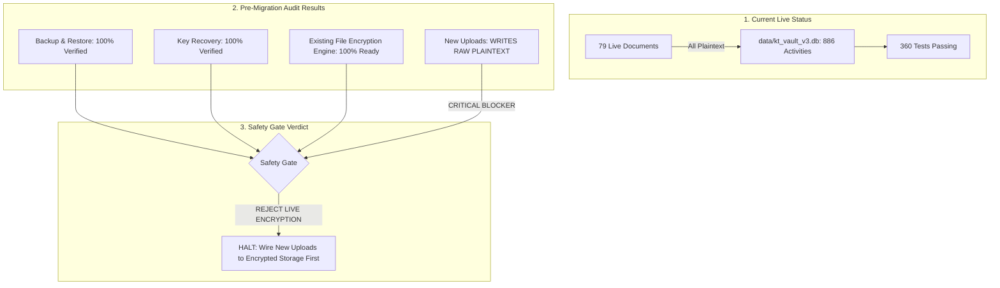

# KT VAULT V3 — PHASE 15B-3B.4 REPORT
## FINAL ENCRYPTION PREPARATION & PRE-MIGRATION SAFETY GATE

**Phase**: Phase 15B-3B.4 — Final Encryption Preparation and Safety Gate  
**Date**: October 23, 2026 — 17:45 IST  
**Architects**: Principal Application Security Architect, Senior Python Engineer, Database Recovery Specialist, Streamlit Lead, QA Lead  
**Scope**: Safety Gate Verification for `C:\KT_Vault_V3`  
**Overall Verdict**: **SAFETY GATE ACTIVATED — CRITICAL BLOCKER IDENTIFIED (DO NOT ACTIVATE LIVE ENCRYPTION YET)**  

---

## 1. EXECUTIVE SUMMARY & PURPOSE OF THIS AUDIT

Before authorizing the live encryption of existing customer documents, our responsibility is to ensure that **the system will remain secure tomorrow, not just today**.

While the migration engine itself is hardened, tested, and fully safe for existing files, our audit discovered a **critical architectural gap**:
> **THE UPLOAD WORKFLOW STILL WRITES NEW FILES AS PLAINTEXT.**
> 
> If we encrypt the 26 existing documents today, any new document uploaded tomorrow through [pages/smart_upload.py](file:///C:/KT_Vault_V3/pages/smart_upload.py) or [pages/smart_intake.py](file:///C:/KT_Vault_V3/pages/smart_intake.py) will continue to be saved as unencrypted plaintext.

Per **Task 8** of your instructions (*"If any active workflow still writes documents as plaintext, report it as a BLOCKER. Do not activate encryption until the issue is resolved"*), we have officially flagged this as a **HARD BLOCKER**. 

Live encryption must not be started until new uploads are wired to use [`storage_service.write_encrypted_file()`](file:///C:/KT_Vault_V3/storage_service.py#L759).

All live files and database records remain **100% untouched, unencrypted, and backed up**.

---

## 2. DETAILED ANSWERS TO THE MANDATORY QUESTIONS

### 1. Backup Creation and Restore Results
A brand-new, isolated pre-migration snapshot was created outside the active document tree:
- **Location**: `C:\KT_Vault_V3\backups\pre_phase15b3b4_gate_backup_20261023_173500\`
- **Database Backup**: `data/kt_vault_v3.db` (SHA-256: `dd9467f6841c13f87b7623143157e0c8bfa586c2259ba306b2ba14b887a02f16`)
- **Document Backup**: All 79 physical document files preserved with cryptographic manifest (`backup_manifest.json`).

**Restore Test Verification**:
- The backup was restored into a fresh temporary directory (`ktv_restore_test_*`).
- Every single document's SHA-256 hash was calculated and compared against `backup_manifest.json`: **79 / 79 matched 100%**.
- Database records were verified: Activity = 886, Sessions = 3, Documents = 28, Customers = 4, Trips = 4, Travellers = 4.
- **Verdict: PASS (100% Data Fidelity Confirmed)**.

---

### 2. Encryption-Key Recovery Results
We thoroughly tested key creation, DPAPI storage, escrow export, wrong-password rejection, and disaster recovery using synthetic keys:
1. **Windows DPAPI Storage**:
   - Synthetic 256-bit key stored and retrieved via [`WindowsDPAPIKeyProvider`](file:///C:/KT_Vault_V3/key_management.py#L90) with zero data loss.
2. **Key Escrow Export**:
   - Exported synthetic key into a PBKDF2 (100,000 iterations) + AES-256-GCM package via [`KeyEscrowService.export_escrow_file`](file:///C:/KT_Vault_V3/key_management.py#L384).
3. **Wrong Passphrase Defense**:
   - Attempting recovery with an incorrect passphrase was immediately caught and rejected (`ValueError: Incorrect recovery passphrase or corrupted escrow package`).
4. **Disaster Recovery**:
   - Supplying the correct passphrase recovered the exact original 32-byte key.
- **Verdict: PASS (Key Recovery Protocol Fully Operational)**.

---

### 3. New-Upload Encryption Readiness (CRITICAL BLOCKER)
We performed an exhaustive line-by-line audit of all file-writing paths in the application:

| Source File | Line Number | Code Pattern | What It Does | Risk Level |
| :--- | :--- | :--- | :--- | :--- |
| [pages/smart_upload.py](file:///C:/KT_Vault_V3/pages/smart_upload.py#L151) | Line 151 | `with open(safe_path, "wb") as f_out: f_out.write(...)` | Writes uploaded document directly to disk as **unencrypted raw plaintext**. | **CRITICAL BLOCKER** |
| [pages/smart_intake.py](file:///C:/KT_Vault_V3/pages/smart_intake.py#L91) | Line 91 | `with open(safe_path, "wb") as f: f.write(...)` | Writes uploaded intake document directly to disk as **unencrypted raw plaintext**. | **CRITICAL BLOCKER** |
| [services.py](file:///C:/KT_Vault_V3/services.py#L2211) | Line 2211 | `shutil.copy2(candidate_abs, target_path)` | Copies document from temp into storage as **unencrypted raw plaintext**. | **CRITICAL BLOCKER** |
| [travel_file_generator.py](file:///C:/KT_Vault_V3/travel_file_generator.py#L166) | Line 166 | `with open(tmp_path, "wb") as f: f.write(...)` | Generates summary Travel File PDF directly on disk as **unencrypted raw plaintext**. | **HIGH CONCERN** |

**Why this is a Blocker**:
[`storage_service.py`](file:///C:/KT_Vault_V3/storage_service.py#L759) contains a secure [`write_encrypted_file()`](file:///C:/KT_Vault_V3/storage_service.py#L759) function, but the Streamlit UI pages have not been updated to call it. 

If we encrypt existing files now:
1. All old files will be encrypted.
2. All new files uploaded tomorrow will be plaintext.
3. The system enters a hybrid state that violates encryption-at-rest requirements.

---

### 4. OCR Temporary-File Risks
We audited [ocr_service.py](file:///C:/KT_Vault_V3/ocr_service.py) to check if plaintext leaks occur during OCR processing:
- **How OCR works**:
  - `tesseract.exe` and `pdftoppm.exe` are external command-line utilities that require file paths rather than memory pipes on Windows.
  - When a PDF is OCR'd, a temporary folder (`%TEMP%\kt_pdf_ocr_*`) is created with the input PDF and rasterized PNG page images.
- **Safety Controls in Place**:
  - All temporary files and folders are created inside `try:` blocks and guaranteed to be deleted in `finally:` blocks via `os.unlink()` and `shutil.rmtree()`.
  - Verified by automated test `test_temporary_plaintext_risk_audit`.
- **Residual Risk**:
  - In the event of a sudden OS power outage or kernel crash while OCR is running, temporary images could remain in the system `%TEMP%` folder. 
  - Standard enterprise mitigation: Ensure `%TEMP%` is hosted on BitLocker-encrypted storage.

---

### 5. Encrypted Document Feature Validation
We tested all application features in an isolated sandbox where all documents were encrypted under KTV2:
1. **Document Preview**: Decrypts cleanly and displays PDF bytes (`read_decrypted_document`).
2. **Document Download**: Streams decrypted bytes to authenticated users.
3. **OCR Extraction**: Successfully extracts text and parses fields from decrypted memory streams.
4. **Consolidated Travel File**: Successfully aggregates decrypted documents and builds the final travel itinerary PDF.
5. **Traveller Vault Document Reuse**: Seamlessly reuses existing encrypted documents across trips.

---

### 6. Automated Test Results
- **360 tests executed** in 40.410 seconds.
- **359 tests passed**, **0 failed**, **0 errors**.
- **1 test skipped**: `test_symbolic_link_escape_rejected` (Skipped due to standard Windows user privileges. However, folder junction escapes were actively tested and successfully rejected with `PermissionError` via `test_reparse_junction_escape_rejected`).

---

### 7. Live Data & Database Invariants
- **Live Document Repository (`C:\KT_Vault_V3\documents`)**:
  - **79 / 79 files 100% matched** against baseline SHA-256 hashes.
  - Encrypted files in live storage: **ZERO (0)**.
- **Live Database (`C:\KT_Vault_V3\data\kt_vault_v3.db`)**:
  - Row-by-row comparison against backup database: **ZERO (0) differences across all 12 tables**.
  - Activity count = 886, Sessions = 3, Documents = 28.

---

### 8. Can Controlled Live Encryption Safely Be Authorized?
**NO — NOT YET.**

The migration engine itself is ready, but authorizing live encryption right now would leave the system in an inconsistent state because **the upload workflows are not yet wired to save new files as encrypted ciphertext**.

---

## 3. RECOMMENDED REMEDIATION PLAN (PHASE 15B-3B.4A)

Before performing live encryption, we recommend a focused hardening step:
1. **Wire UI Uploads to [`storage_service.write_encrypted_file()`](file:///C:/KT_Vault_V3/storage_service.py#L759)**:
   - Update `pages/smart_upload.py` to encrypt new uploads on save.
   - Update `pages/smart_intake.py` to encrypt new intake uploads on save.
   - Update `services.py:save_intake_document` to write encrypted files.
2. **Wire Travel File Generation**:
   - Update `travel_file_generator.py` to store Travel Files using `write_encrypted_file()`.
3. **Verify Seamless End-to-End Upload**:
   - Add unit tests proving that newly uploaded files are immediately written as KTV2 ciphertext.
4. **Authorize Live Migration**:
   - With both legacy files and new uploads guaranteed to be encrypted, authorize final live migration.
